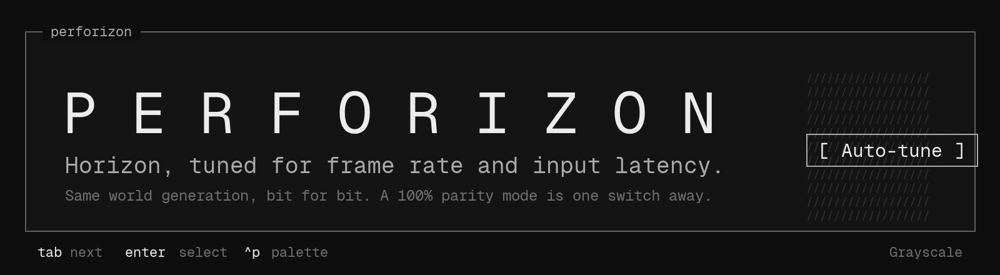
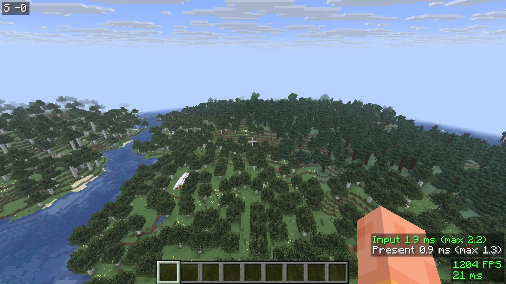
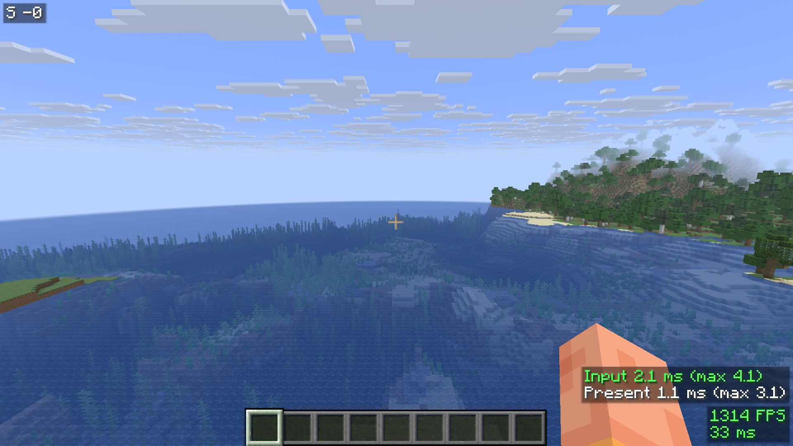
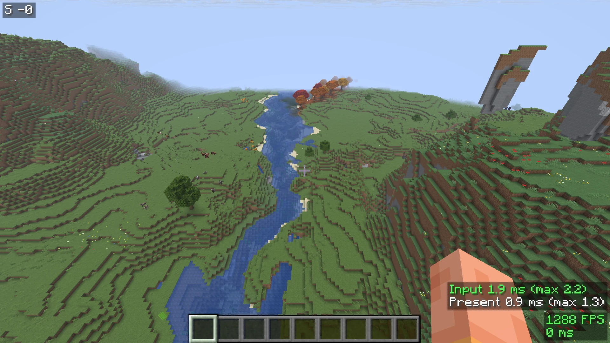
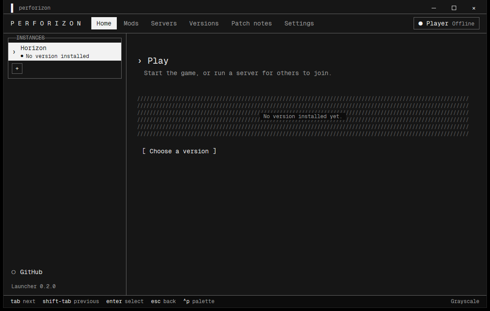
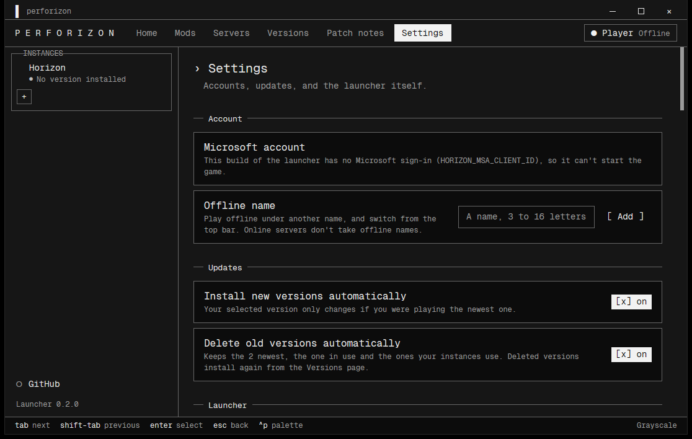
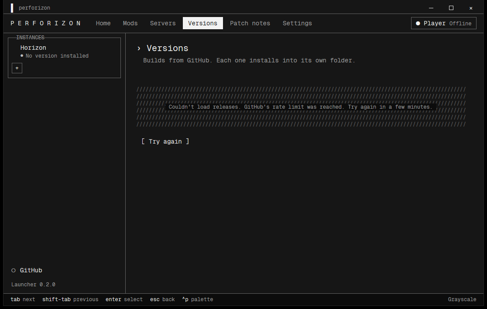
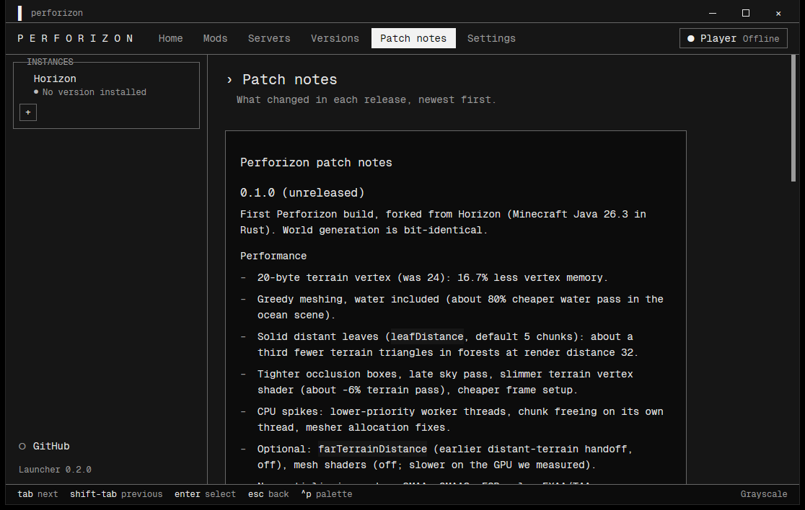

<p align="center">
  
</p>

<p align="center">
  
  
  <a href="LICENSE"></a>
  <a href="https://github.com/Louchatfroff/Perforizon/releases/tag/v0.1.0"></a>
</p>

```
P E R F O R I Z O N
> Horizon, tuned for frame rate and input latency
```

Perforizon is a performance fork of [Horizon](https://github.com/horizon-rust/horizon), Minecraft: Java Edition 26.3 rewritten in Rust (wgpu). It keeps Horizon's worlds and world generation identical and goes after frame rate, frame-time spikes and input-to-screen latency. It adds an in-game auto-tune, a choice between a Performance and a 100% parity mode, extra antialiasing modes, a latency counter and a PvP module.

Perforizon is unofficial and is not affiliated with Mojang or Microsoft. It does not include Minecraft: you need your own copy of Minecraft Java 26.3, from which the game files are prepared on your machine. Perforizon is based on Horizon (MIT).

```
[ Install ]  [ Auto-tune ]  [ Wiki ]  [ Releases ]
  windows x64 only for now, signed releases
```

[Install](#install) | [Auto-tune](#auto-tune-in-3-steps) | [Wiki](https://louchatfroff.github.io/Perforizon/) | [Releases](https://github.com/Louchatfroff/Perforizon/releases) | [Build](#build-from-source)

## Why Perforizon

Measured against Horizon built the same way, default settings, render distance 32, `--benchmark standard` (seed 1234, offscreen 1280x720, VSync off, simulation distance 12), RTX 4060 Ti, average of 3 runs:

| Scene | Horizon fps | Perforizon fps | Change | 1% low change |
| --- | ---: | ---: | ---: | ---: |
| village | 1214 | 1278 | +5% | +16% |
| forest | 943 | 1362 | +44% | +35% |
| ocean | 1121 | 1410 | +26% | +26% |
| mountain | 860 | 914 | +6% | +24% |

Caveats, stated plainly:

- One machine, one GPU, offscreen 720p. Read it as a comparison between two builds, not as a promise for your hardware.
- The Far LOD option (distant terrain with coarser tiles) is not a free win. At render distance 32 it adds +107% in forest and ocean and +26% in mountain, but costs 13% in village, and at render distance 16 it is level or slower. It changes pixels (flatter distant trees) and is off by default; the auto-tune keeps it only if it helps on your machine.
- Full tables (render distance 16 and 32, auto-tuned column, 1% and 0.1% lows): [docs/perforizon-benchmarks.md](docs/perforizon-benchmarks.md).

## Features

```
> defaults        on for everyone, no setup
> opt-in          off by default, the auto-tune decides
> modes           performance | parity
```

**On by default**
- 20-byte terrain vertex (was 24), greedy meshing including water, solid distant leaves (`leafDistance`), tighter occlusion boxes, a lighter terrain vertex shader.
- Fewer CPU spikes: lower-priority worker threads, chunk freeing on its own thread, mesher allocation fixes.
- Cave culling, entity culling and a shadow cache.

**Opt-in GPU options (the auto-tune decides)**
- Far LOD (`farLodCoarse` with `farTerrainDistance`), vertex pool, binary greedy meshing, mesh shaders, Hi-Z occlusion, BC7 texture compression, shadow GPU culling, GPU particles.
- On the reference GPU only Far LOD paid off; the others showed no gain or were within noise, so they stay off there. Other GPUs may differ. Details: [docs/perforizon-technical.md](docs/perforizon-technical.md).

**Optimization Mode**
- `Performance` (default): allows optimizations that change a few pixels.
- `100% parity`: turns those off so the picture matches Horizon's; only lossless speedups stay.

**Latency and antialiasing**
- Input-to-screen latency counter (`latencyHud`), `presentMode` and `frameLatency` picked by the auto-tune, optional packet batching and pipeline cache.
- Antialiasing: FXAA, TAA, SMAA, CMAA2, plus FSR scaling.

**PvP module** (`Options > Horizon > PvP`)
- Hit prediction, crystal and anchor optimizers, elytra stop. Prediction is not tested on a live server yet.
- Small HUD overlays (armor, effects, coordinates, direction, ping, combo, reach, items), hitboxes, projectile trails, toggle sprint and sneak.

**Launcher**
- Terminal-style launcher with 16 palettes (default Grayscale), no ads. It installs and updates Perforizon releases and verifies their signature.

Release notes: [docs/perforizon-patchnotes.md](docs/perforizon-patchnotes.md).

## Screenshots

Game:

<p align="center">
  
  
  
</p>

Launcher:

<p align="center">
  
  
</p>
<p align="center">
  
  
</p>

## Install

Windows x64 only. PowerShell, no admin rights:

```powershell
irm https://raw.githubusercontent.com/Louchatfroff/Perforizon/main/packaging/windows/install-perforizon.ps1 | iex
```

It downloads the latest `Perforizon-windows-x64.zip`, checks it against the release's `SHA256SUMS`, unpacks to `%LOCALAPPDATA%\Perforizon` and adds a Start Menu shortcut.

Or download the zip from the [Releases page](https://github.com/Louchatfroff/Perforizon/releases) and unzip it by hand.

How releases are verified:
- Every release ships `SHA256SUMS` and a signature, `SHA256SUMS.sig`.
- The launcher checks that signature against the keys in `crates/horizon-release-sign/release-keys.txt`. The one-line installer only checks the checksum, not the signature; to authenticate a manual install, compare the SHA-256 it prints with the one published by the author.

Prepare the game files from your own copy of Minecraft Java 26.3, as for Horizon (see `PLAY.txt` in the install folder):

```
horizon-prepare.exe --prepare --server-jar <your server.jar>
```

More: [docs/perforizon-install.md](docs/perforizon-install.md).

## Auto-tune in 3 steps

1. Open a creative or single-player world and stand where you normally play, at your usual render distance.
2. `Options > Video Settings > Advanced Graphics > Auto-tune > Run Auto-tune...` (about two minutes). For a slower, more careful run on the four benchmark scenes, use `Run Precise Auto-tune...` (about 30 minutes on the reference machine).
3. Done: the result is saved to your graphics options. Run it again after changing render distance, GPU or shader pack.

Command line equivalent: `horizon-ctl autotune`, `horizon-ctl autotune --precise`. Full guide: [docs/perforizon-autotune.md](docs/perforizon-autotune.md).

## Settings cheat sheet

Under `Options > Video Settings > Advanced Graphics`; `horizon-ctl graphics KEY VALUE` sets them live.

| Option | Default | What it does |
| --- | --- | --- |
| `optimizationMode` | `performance` | `parity` disables the pixel-changing optimizations |
| `greedyMeshing` | on | Merges coplanar faces, water included |
| `leafDistance` | 5 | Chunks within which leaves stay fancy; solid beyond. `0` = fancy everywhere |
| `farTerrainDistance` | 0 (off) | Earlier handoff to distant-terrain tiles |
| `farLodCoarse` | off | Coarser distant tiles; changes pixels |
| `caveCulling`, `entityCulling`, `shadowCache` | on | Lossless or near-lossless |
| `meshShaders` | off | Faster on some GPUs, slower on the RTX 4060 Ti tested |
| `vertexPool` | off | One large terrain buffer instead of several |
| `hizOcclusion` | off | Same pixels; a loss on the reference GPU |
| `textureCompression` | off | BC7 block sprites; lossy |
| `presentMode` | auto | Auto-tune also tries `mailbox` (VSync off only) |
| `frameLatency` | 0 (auto) | Queued frames |
| `latencyHud` | off | Shows input-to-screen delay in the PvP HUD |
| Antialiasing | none | FXAA, TAA, SMAA, CMAA2 |

All options and their measured effects: [docs/perforizon-autotune.md](docs/perforizon-autotune.md).

## Keeping up with Horizon

Perforizon follows upstream Horizon automatically: it checks hourly for new upstream commits and merges them in only when all checks pass; otherwise it opens an issue or a pull request for a human to look at. Details: [docs/perforizon-sync.md](docs/perforizon-sync.md).

## Wiki

A terminal-style wiki (same look as the launcher) lives at <https://louchatfroff.github.io/Perforizon/>.

## Build from source

Needs Rust 1.90+ and, for preparing game files, Python 3.10+ and JDK 25. Windows x64 is the packaged target.

```sh
git clone https://github.com/Louchatfroff/Perforizon.git
cd Perforizon
cargo build --profile fast -p horizon-client
```

Release build and Windows package (writes `dist\Perforizon-windows-x64.zip` and `dist\SHA256SUMS`):

```powershell
tools\package_windows.ps1                 # release profile; -Profile fast for a quick build
```

The launcher is its own workspace: `cd launcher && cargo build --release --locked`. Never commit Mojang's files (jars, assets, prepared resources); see [CONTRIBUTING.md](CONTRIBUTING.md).

## Contributing and issues

GitHub Issues are currently disabled on this repository. For now, contact the repository owner (Louchatfroff) through GitHub. Read [CONTRIBUTING.md](CONTRIBUTING.md) before sending code; changes that are not Perforizon-specific are better sent to [Horizon](https://github.com/horizon-rust/horizon).

## Credits and licenses

- **Horizon** by Ludovic Marie and the Horizon contributors, MIT: the base of this project. <https://github.com/horizon-rust/horizon>
- **Perforizon** changes are MIT too. See [LICENSE](LICENSE).
- **Geist Mono** (launcher and wiki font) by Vercel, SIL Open Font License; text in `crates/horizon-theme/fonts/OFL-Geist.txt`.
- **CMAA2** antialiasing is a WGSL/wgpu port of Intel CMAA2 (Copyright 2018 Intel Corporation, Filip Strugar), Apache License 2.0; see [the notice](crates/horizon-client-render/src/gfx/aa/cmaa2.NOTICE).
- Other third-party code (AMD FidelityFX SDK ports and more): [THIRD_PARTY_NOTICES.md](THIRD_PARTY_NOTICES.md).

Minecraft is a trademark of Mojang Studios / Microsoft. Perforizon is not affiliated with them and ships none of their files.
