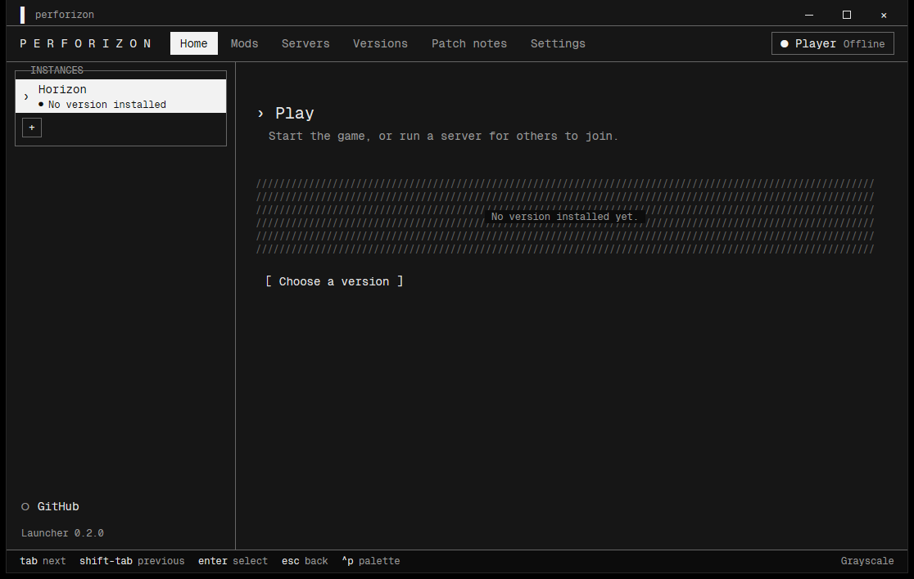
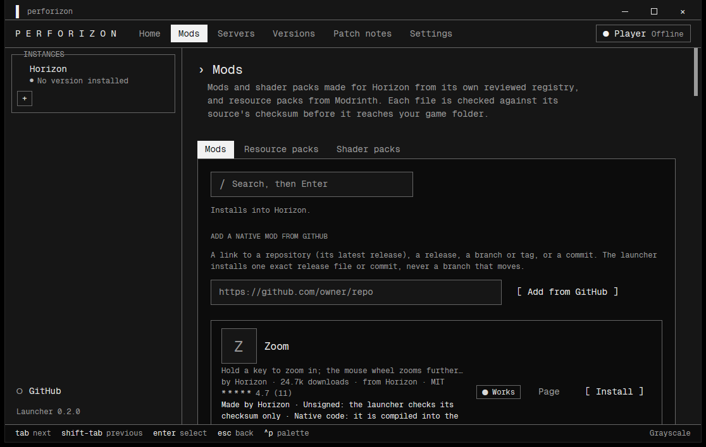
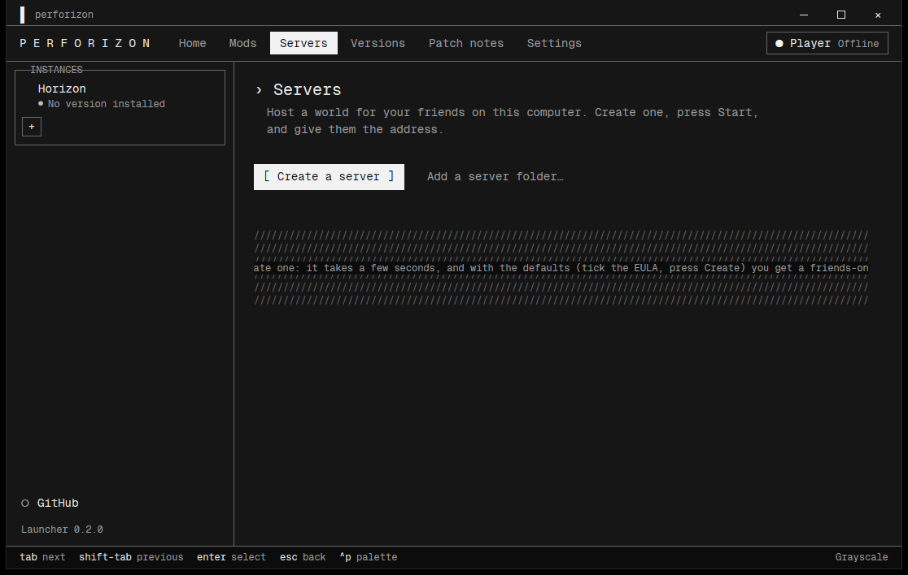
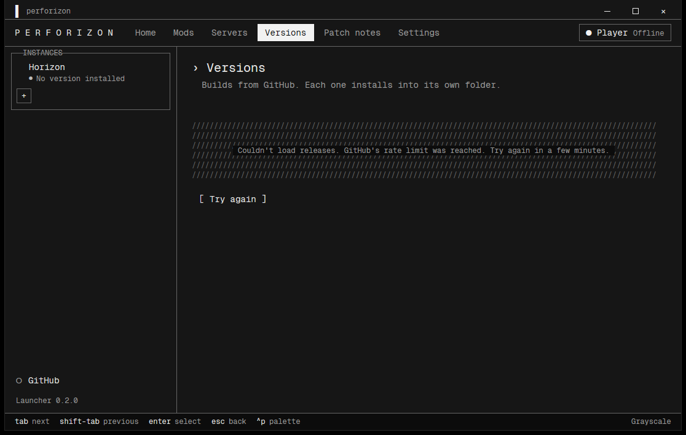
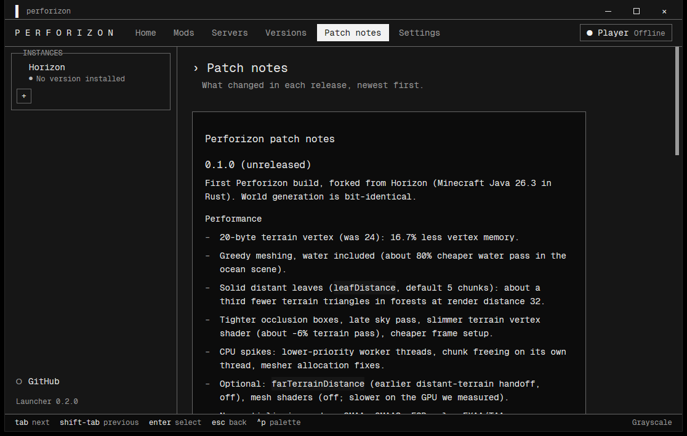
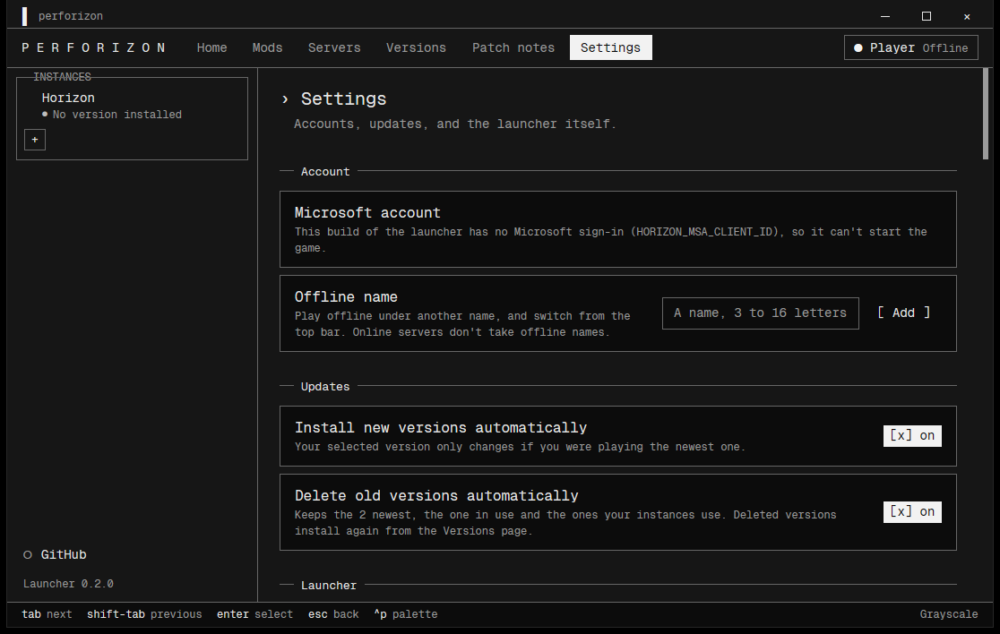
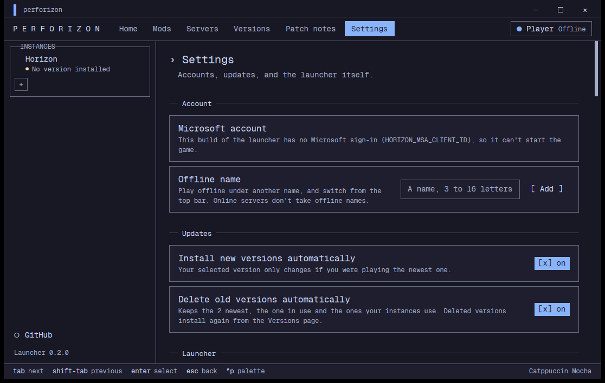

# First launch

The launcher is a terminal-style window: Geist Mono, titled borders on panels, hatched empty states, a key-hint line at the bottom, grayscale by default. It is built from `launcher/` and installs and updates Perforizon releases. More in [Launcher](10-launcher.md); the one-line installer in [Install](02-install.md) does not need it.

The spaced wordmark `P E R F O R I Z O N` sits at the left of the top bar, followed by the pages: Home, Mods, Servers, Versions, Patch notes, Settings. The account chip is at the right. The footer shows the keys and the active palette.

## Home

The Instances panel is on the left, and page titles carry a `›` caret. With no version installed the page shows a hatched empty state and a `[ Choose a version ]` button. Once a version is installed this page starts the game, or runs a server for others to join.

## Mods

Mods and shader packs made for Horizon from its reviewed registry, and resource packs from Modrinth. Each file is checked against its source's checksum before it reaches your game folder. Tabs: Mods, Resource packs, Shader packs. There is a search box and a box to add a native mod from a GitHub link.

## Servers

Host a world for your friends on this computer: create a server, press Start, give them the address. Use `[ Create a server ]`, or add an existing server folder.

## Versions

Builds from GitHub, each installed into its own folder. If GitHub's rate limit is reached the page says so and offers `[ Try again ]`; wait a few minutes.

## Patch notes

What changed in each release, newest first.

## Settings

Account (Microsoft sign-in where the build has it, or an offline name), updates (install new versions automatically, delete old versions automatically) and the launcher itself, including language and palette.

## Palettes and key hints

The footer reads `tab next`, `shift-tab previous`, `enter select`, `esc back`, `^p palette`, and the palette name at the right. `^p` (Ctrl+P) opens the palette switcher. The default is Grayscale; there are 16 palettes, listed in [Launcher](10-launcher.md). For example, Catppuccin Mocha:

## Then

1. Pick a version on Versions and install it.
2. Prepare your game files if the launcher asks.
3. Start a creative world and run the [auto-tune](04-auto-tune.md).
