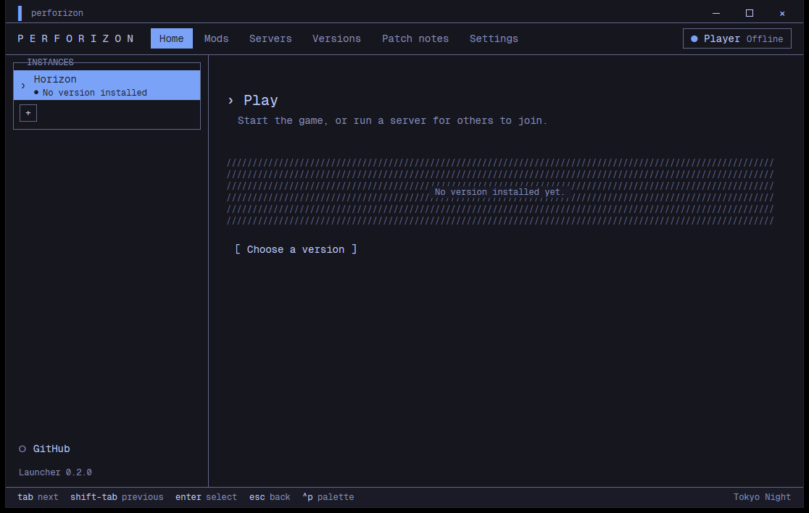

# Launcher

The launcher is adapted from Horizon's. It lists and installs releases of `Louchatfroff/Perforizon`, looks for the asset `Perforizon-windows-x64.zip`, and checks the signed checksums against the keys in `crates/horizon-release-sign/release-keys.txt`. A page-by-page tour is in [First launch](03-first-launch.md).

It has no ads. It manages accounts (a Microsoft account where the build has sign-in, or an offline name), instances, mods, shader packs, servers and versions.

## Look

- Terminal style, set in Geist Mono.
- Panels have titled borders: the label sits on the top border.
- Empty states are hatched with `/////`.
- A key-hint line at the bottom: `tab next`, `shift-tab previous`, `enter select`, `esc back`, `^p palette`.
- Block progress bars, `[ bracketed ]` buttons, a `›` caret before page titles.
- The spaced wordmark `P E R F O R I Z O N`.

## Palettes

Grayscale is the default. `^p` opens the palette switcher; the name of the active palette is shown at the right of the footer.

| Name (for the command) | Label | Kind |
| --- | --- | --- |
| `grayscale` | Grayscale | dark (default) |
| `tokyo-night` | Tokyo Night | dark |
| `tokyo-night-storm` | Tokyo Night Storm | dark |
| `catppuccin-latte` | Catppuccin Latte | light |
| `catppuccin-frappe` | Catppuccin Frappe | dark |
| `catppuccin-macchiato` | Catppuccin Macchiato | dark |
| `catppuccin-mocha` | Catppuccin Mocha | dark |
| `gruvbox-dark` | Gruvbox Dark | dark |
| `nord` | Nord | dark |
| `dracula` | Dracula | dark |
| `rose-pine` | Rose Pine | dark |
| `solarized-dark` | Solarized Dark | dark |
| `solarized-light` | Solarized Light | light |
| `one-dark` | One Dark | dark |
| `kanagawa` | Kanagawa | dark |
| `everforest` | Everforest | dark |

From the command line:

```powershell
horizon-launcher settings palette tokyo-night
horizon-launcher settings palette default      # back to grayscale
horizon-launcher settings                      # show every setting
```

An unknown name is refused with the list of valid ones. Each palette has a test that checks its text contrast.



## Other settings

`horizon-launcher settings KEY VALUE` also takes `selected-version`, `minecraft-dir`, `server-dir`, `install-new-versions on|off`, `prune-old-versions on|off`, `keep-versions N`, `opening-animation on|off`, `proxy`, `while-playing stay|minimize|hide`, `language` and `native-profile`. The full command list is in the repository at `docs/launcher-commands.md`.

## Build it

From `launcher/`: `cargo build --release --locked`. The repository the launcher installs from is set at build time with `PERFORIZON_REPO=owner/name` (default `Louchatfroff/Perforizon`). See [Build from source](12-build-from-source.md).

Only the Windows asset is renamed; other platforms are not packaged by this fork.
